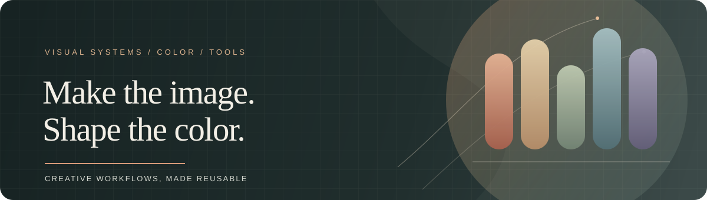

# 把审美判断，沉淀成可复用的工具。

**视觉创作 · 影像与色彩 · 创作型工具**

从画面和色彩实验出发，把想法整理成能持续使用的工作流。

[创作工具](https://github.com/kaiyihe699-max/codex-skills)　·　[古籍版式实验](https://github.com/kaiyihe699-max/classical-page-lab)

---

## 精选项目

### [Codex Skills](https://github.com/kaiyihe699-max/codex-skills)

为视觉创作、影像处理与创意工作流打造的 Codex Skills。包含 [LUT 生成与调色工作流](https://github.com/kaiyihe699-max/codex-skills/tree/main/generate-lut)，覆盖松下 S9 相机配置、预览、校验与批量处理。

### [Classical Page Lab](https://github.com/kaiyihe699-max/classical-page-lab)

把现代中文转译为具有古籍版式逻辑的静态与互动叶面，并输出结构化校验结果。

## 关注方向

- **影像与色彩** — LUT 创作、相机兼容与可复用的调色流程
- **视觉系统** — 把版式、色彩和创作规则沉淀成可操作的工具
- **创意实验** — 从静态作品延伸到互动页面与小型工作流

---

*Make images. Shape color. Build useful tools.*
